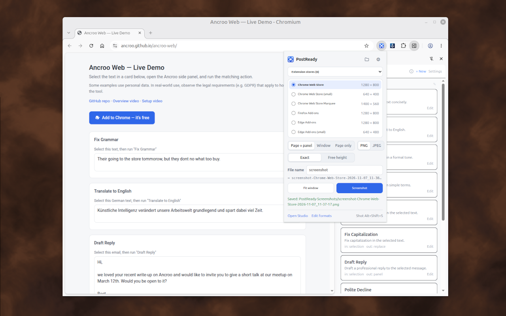
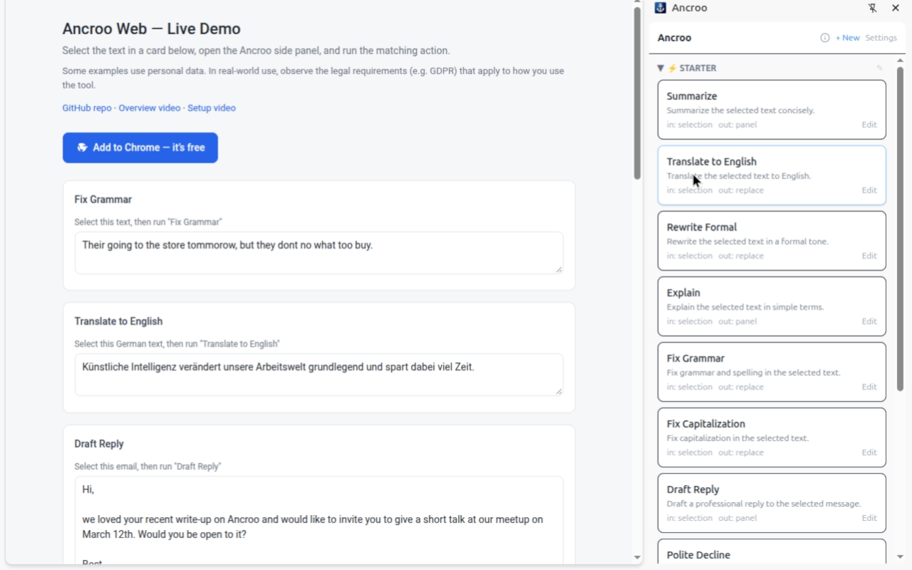
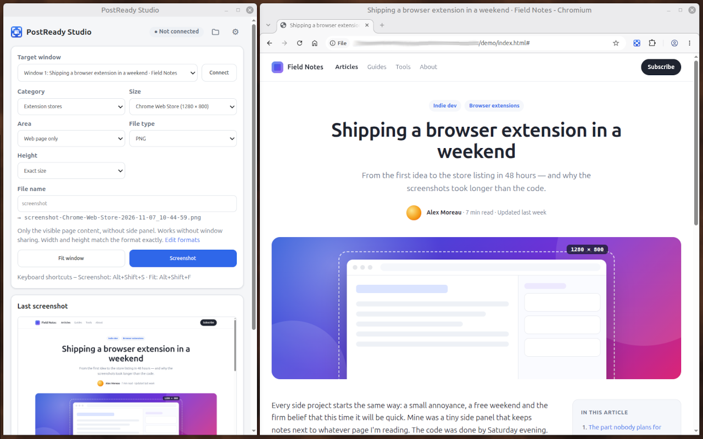
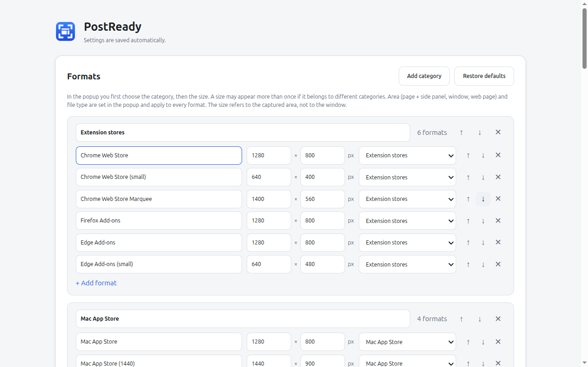

# PostReady Screenshots

A Chrome extension (Manifest V3) that takes screenshots in the exact size a
platform asks for — LinkedIn, Medium, Substack, X, YouTube, blogs and app
stores such as the Chrome Web Store (1280 × 800). Instead of cropping
afterwards, PostReady resizes the browser window so the captured area matches
the format, optionally including the side panel or the whole browser window, and
saves the image as PNG or JPEG with one click.

The extension does **not** use the side panel itself, so it stays free for the
extension you want to show off.

## Installation

Requires Chrome 116 or newer.

1. Clone this repository.
2. Open `chrome://extensions/`.
3. Enable **Developer mode** in the top right.
4. Click **Load unpacked** and select that folder.
5. Optionally pin the extension to the toolbar.

## Usage

1. In the popup, pick a **category** (e.g. *Extension stores*) and then a
   **size** (e.g. *Chrome Web Store* – 1280 × 800).
2. Choose the **area**, the **height** (*Exact* or *Free height*, see below) and
   the **file type** (PNG/JPEG) — they apply to every size.
3. Optionally enter a **file name** (empty = `screenshot`). Images are saved as
   `name-format-timestamp`, e.g.
   `release-2.0-Chrome-Web-Store-2026-10-29_14-05-12.png`; the preview below the
   field shows the exact name. <kbd>Enter</kbd> in the field takes the
   screenshot.
4. Click **Screenshot** or press <kbd>Alt</kbd>+<kbd>Shift</kbd>+<kbd>S</kbd>.
5. For *Page + side panel* and *Whole window*, the **Studio window** opens the
   first time and asks which window to share → pick the Chrome window with your
   page. *Web page only* needs no Studio.
6. The Studio fits the window, captures and saves to `Downloads/PostReady-Screenshots/`.
   The folder button next to ⚙ (in the popup and the Studio) opens that folder
   with the last screenshot selected.

As long as the Studio stays open (minimised is fine), every further screenshot
takes one click or the shortcut. <kbd>Alt</kbd>+<kbd>Shift</kbd>+<kbd>F</kbd>
only fits the window.

### Capture areas

| Area | Content | How |
| --- | --- | --- |
| **Page + side panel** | Everything below the toolbar: web page including an open side panel | Window sharing (Studio) |
| **Whole window** | The complete browser window with tab strip and toolbar | Window sharing (Studio) |
| **Web page only** | The visible page content without side panel | `captureVisibleTab`, no Studio needed |

*Whole window* means Chrome's own window. A title bar drawn by the desktop
(Linux with Chrome's *Use system title bar and borders*) is not part of it and
not included in window sharing, so the window on screen is taller than the
image. Turn that Chrome setting off to get Chrome's own title bar with the tabs
— then the image matches what you see.

### Exact size or free height

| Height | Before the screenshot | Result |
| --- | --- | --- |
| **Exact** | Width and height are fitted | exactly the format, e.g. 1280 × 800 |
| **Free height** | Only the width is fitted, the window height stays | format width × whatever height the window has, e.g. 1280 × 1043 |

With *Free height* you can first click **Fit window** (always the exact
size), then drag the window taller or shorter by hand and take the screenshot —
it keeps your height. The `{h}` placeholder in the file name is the actual
height.

### Why a Studio window?

Extensions can only capture the side panel and the browser interface through
window sharing (`desktopCapture`). The stream has to live in an open page — but
the toolbar popup closes as soon as the sharing dialog appears. So a small
window of its own holds the stream.

## How the exact size is achieved

- The size of a format applies to the **captured area**, not to the window.
  PostReady measures the toolbar, borders etc. and resizes the window so that,
  for example, page + side panel are exactly 1280 × 800.
- Sizes are **logical pixels** (CSS pixels), the unit Chrome uses for windows
  and web pages. With display scaling, the window on screen is larger by that
  factor: at 130 % (on Linux this includes GNOME's text scaling factor), a
  1280 × 800 area covers about 1664 × 1040 physical pixels. The page lays out
  as it would at 1280 × 800 without scaling; the capture is taken at full
  resolution and scaled down to the target size — very sharp at 200 %,
  slightly softer at odd factors such as 125 % or 130 %.
- For a 1:1 capture without any scaling, either choose *physical screen pixels*
  in the settings (the page then shows less content, since everything is
  larger), or start Chrome with `--force-device-scale-factor=1`.
- Invisible window borders (Windows) and shadow borders (Linux) are detected and
  calibrated automatically; fractional scaling (e.g. 125 %) is handled.
- **Lossless page content:** the window-sharing image is a video frame (slightly
  softer colour edges). The web page itself is therefore inserted pixel-perfect
  from a tab capture; only the side panel and browser UI come from the video
  frame. Chrome blocks this on `chrome://` pages and the Web Store — there the
  whole image comes from window sharing.
- If the aspect ratio doesn't match (e.g. the screen is too small for 1280 × 800
  plus toolbar), the capture stops with a clear message instead of distorting
  (except with *Free height*, where only the width counts).

## Settings

Right-click the icon → **Options** (or ⚙ in the popup):

- **Formats:** add, rename, sort and delete categories; add and sort formats
  (name, width, height) and move them to another category. The same size may
  appear in several categories. *Restore defaults* resets the bundled library
  (Extension stores, Mac App Store, LinkedIn, Articles & blogs, README & Docs,
  Web & Social, Screen sizes). New default categories of later versions are added
  automatically without touching your own changes.
- Automatic window fitting, countdown (shown on the toolbar icon), window border.
- Subfolder, file name pattern (`{base}`, `{name}`, `{category}`, `{w}`, `{h}`,
  `{timestamp}`, `{date}`, `{time}`, `{title}`, `{mode}`, `{nr}` — German
  placeholders such as `{basis}` or `{zeitstempel}` work as well), JPEG quality,
  "Save as" dialog.
- Hide Chrome's download bubble while saving, so it doesn't end up in the next
  window screenshot.

Keyboard shortcuts can be changed at `chrome://extensions/shortcuts`.

## Languages

The interface is available in English (default) and German; Chrome picks the
language from the browser settings.

- Texts live in `_locales/<language>/messages.json` (store name, description,
  interface, messages). HTML uses `data-i18n` attributes, scripts use `t()` from
  `lib/i18n.js`.
- The names of the bundled formats are bilingual in `lib/settings.js` and
  follow the browser language. Once renamed, a name stays as the user typed it.
- New language: add `_locales/<code>/` with all keys from
  `_locales/en/messages.json`.

## Notes

- On Wayland, the system (xdg-desktop-portal) handles the window selection.
- The mouse pointer may be visible in the window share — over the web page it is
  removed automatically by the lossless page content. Use the countdown to move
  it away.
- Extension popups (toolbar bubbles) are separate system windows and don't
  appear in the window image.

## Packaging and releases

`./build.sh` packs only the runtime files into `dist/postready-<version>.zip`.
The release setup is documented in [RELEASING.md](RELEASING.md), store texts and
permission justifications in [STORE.md](STORE.md).

## Privacy

PostReady Screenshots does not collect, transmit, or share any data. All
screenshots are saved directly to your local Downloads folder. See
[PRIVACY.md](PRIVACY.md) for details.

## Security

To report a security vulnerability, please use
[GitHub's private vulnerability reporting](https://github.com/Stefan-Schmidbauer/postready-screenshots/security/advisories/new)
instead of opening a public issue.

## Support

Questions or feedback? Email [support@ancroo.com](mailto:support@ancroo.com) or
open an [issue](https://github.com/Stefan-Schmidbauer/postready-screenshots/issues).

## Trademarks

PostReady Screenshots is not affiliated with or endorsed by LinkedIn,
X/Twitter, YouTube, Medium, Substack, dev.to, Hashnode, Product Hunt, GitHub,
Google, Mozilla, Microsoft or Apple. Product names are used only to describe
image formats; all trademarks belong to their respective owners.

## License

MIT — see [LICENSE](LICENSE).

## Author

**Stefan Schmidbauer** — [GitHub](https://github.com/Stefan-Schmidbauer) · [stefan@ancroo.com](mailto:stefan@ancroo.com)

---

Built with the help of AI ([Claude](https://claude.ai) by Anthropic).
